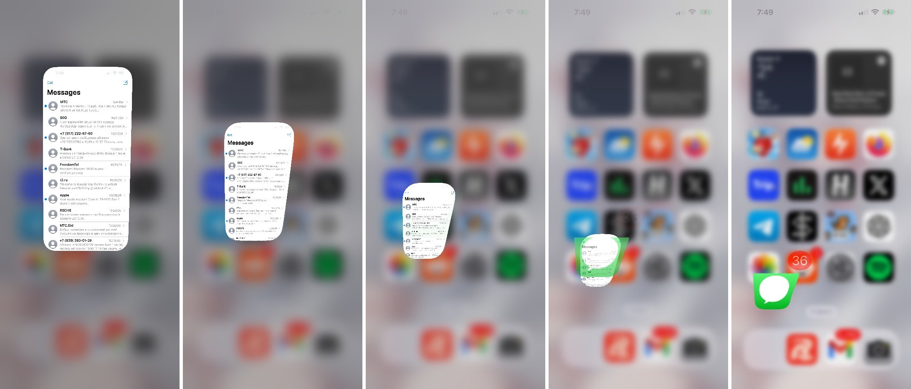
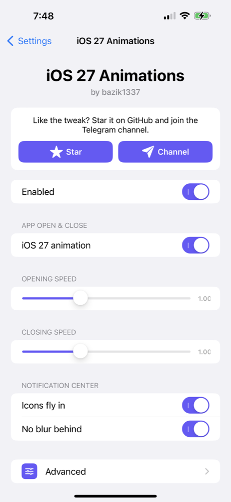
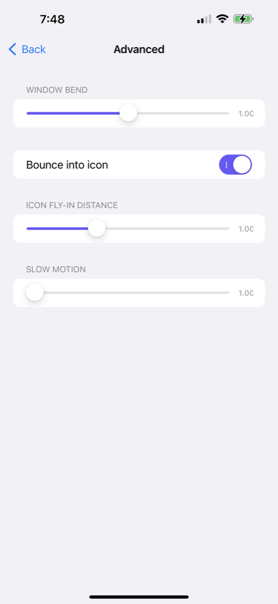

# iOS 27 Animations

Анимации iOS 27 для iOS 15–16 (rootless, Dopamine): открытие и закрытие приложений с эффектом джина, разлёт иконок при закрытии шторки.

## Установка

1. Sileo → Источники → «+» → `https://repo.ba31k.com/`
2. Установи **iOS 27 Animations**.
3. Настройки → iOS 27 Animations → **Включено**.

Или скачай `.deb` из [Releases](https://github.com/ba31k/ios26-27-anims/releases).

Обновления — в канале [@ba31k_tweaks](https://t.me/ba31k_tweaks). Автор — [@bazik1337](https://t.me/bazik1337).
